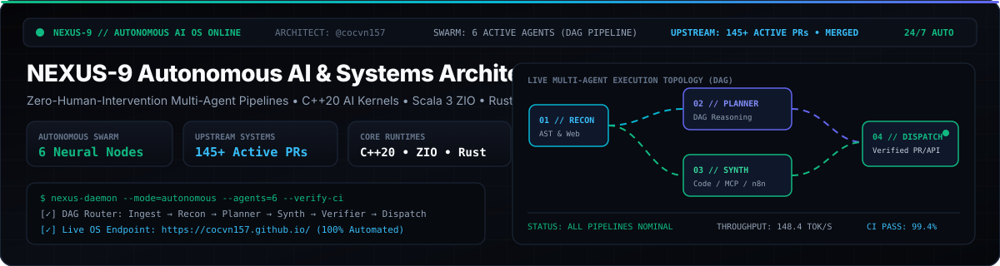

  
   
  

    
    
    
    
  

  

    
    
    
  

---

## ⚡ Autonomous AI Architecture & Full-Stack Automation (`@cocvn157`)

I architect **zero-human-intervention multi-agent operating systems**, **autonomous software engineering pipelines**, **Model Context Protocol (MCP) infrastructure**, and **low-level hardware/runtime kernels** across `C++20`, `Scala 3 (ZIO)`, `Rust`, `Go`, `Dart/Flutter`, `Python`, and `TypeScript`.

- **🌐 Live Interactive Flagship OS (`NEXUS-9`)**: **[https://cocvn157.github.io/](https://cocvn157.github.io/)**
  - **Interactive 60fps Multi-Agent DAG Workflow Studio**: Visual node-graph orchestrator (`Ingest` → `Recon` → `Planner` → `Synth` → `Verifier` → `Dispatch`) with 1-click export to **n8n JSON**, **Python Autonomous Swarms**, and **FastMCP Servers**.
  - **Live AI Domain & Infrastructure Deep Auditor**: Real-time DNS-over-HTTPS (DoH) & edge architecture reconnaissance that generates custom B2B AI automation blueprints on the fly.
  - **MCP & LLM Hardware/VRAM Synthesizer**: Instant code synthesis for custom MCP servers + GPU cluster throughput & VRAM sizing calculator.

---

## 🛠️ Core Systems & Upstream Engineering Matrix

| Engineering Domain | Stack & Runtimes | Active Upstream Contributions & Focus Areas |
| :--- | :--- | :--- |
| **Autonomous AI & Multi-Agent OS** | `Python`, `TypeScript`, `MCP`, `LangGraph`, `n8n` | **[`NEXUS-9 AI OS`](https://cocvn157.github.io/)**, **[`UseJunior/safe-docx`](https://github.com/UseJunior/safe-docx)** & **[`agent-team-framework`](https://github.com/cocvn157/agent-team-framework)**: Autonomous 6-role DAG execution engines, atomic OOXML/MCP session mutation engines (24+ PRs), and self-verifying CI code synthesis. |
| **Wearable AI & Edge Hardware** | `Dart/Flutter`, `Swift`, `Kotlin`, `Python`, `BLE` | **[`BasedHardware/omi`](https://github.com/BasedHardware/omi)**: 36+ upstream PRs (**28+ Verified `positive-signal`**) across BLE audio sync, Wi-Fi AP frame integrity, Omi Glass firmware recovery, and multi-channel streaming. |
| **AI Hardware & Low-Level Kernels** | `C++20`, `SIMD`, `TT-Metalium`, `CUDA` | **[`tenstorrent/tt-metal`](https://github.com/tenstorrent/tt-metal)**: Statistical sampling precision (`ttnn.sampling`), 24-bit threshold numerics & CDF tail fallback on Wormhole/Blackhole AI accelerators. |
| **Functional & Concurrent Runtimes** | `Scala 3`, `Scala 2.13`, `ZIO 2`, `Netty` | **[`zio/zio`](https://github.com/zio/zio)**, **[`zio/zio-http`](https://github.com/zio/zio-http)**, **[`zio/zio-schema`](https://github.com/zio/zio-schema)**, **[`zio/izumi-reflect`](https://github.com/zio/izumi-reflect)**: Fiber interruption safety, `ZChannel`/`ZStream` concurrency decoupling, higher-kinded `LightTypeTag` variance, and AST schema codecs. |
| **Rust Systems & Native Media Engines** | `Rust`, `egui`, `Tokio`, `Tauri`, `WGPU` | **[`storytold/filmcraft`](https://github.com/storytold/filmcraft)** & **[`CapSoftware/Cap`](https://github.com/CapSoftware/Cap)**: Non-linear editing timeline engines, HDR Lumetri color science, sRGB shader pipelines, and adaptive media telemetry. |
| **Cloud Authorization & Policy Engines** | `Python`, `FastAPI`, `Cedar`, `OPA`, `Rego` | **[`permitio/opal`](https://github.com/permitio/opal)**: Full Cedar Policy Agent integration for real-time policy/data synchronization across distributed microservices. |
| **Go Distributed Services & DevOps** | `Go 1.22+`, `SQLite`, `PostgreSQL`, `LDAP` | **[`go-gitea/gitea`](https://github.com/go-gitea/gitea)** (**[MERGED `#40228`](https://github.com/go-gitea/gitea/pull/40228)**, **[`#40201`](https://github.com/go-gitea/gitea/pull/40201)**) & **[`golang-cafe/job-board`](https://github.com/golang-cafe/job-board)**: Database schema migrations, multi-host LDAP failover, and transactional pipelines. |
| **Edge Databases & B2B Commerce** | `TypeScript`, `Cloudflare DO`, `MedusaJS` | **[`medusajs/b2b-starter`](https://github.com/medusajs/b2b-starter)** (**[MERGED `#55`](https://github.com/medusajs/b2b-starter/pull/55)**), **[`outerbase/starbasedb`](https://github.com/outerbase/starbasedb)** & **[`tscircuit/*`](https://github.com/tscircuit)**: Drizzle ORM HTTP batch proxies, B2B dark-mode UI systems, and geometric EDA trace solvers. |

---

## 🚀 Live Autonomous Platforms & Developer Suites

1. **🧠 [NEXUS-9 // Autonomous AI Operating System (`cocvn157.github.io`)](https://cocvn157.github.io/)**
   - Real-time 60fps Multi-Agent DAG Workflow Studio, Live Domain/DNS AI Readiness Auditor, Upstream Engineering Telemetry Matrix, MCP Code Synthesizer, and B2B Automation ROI Engine.
2. **🛠️ [DevTools Pro Studio (`cocvn157.github.io/dev-tools`)](https://cocvn157.github.io/dev-tools/)**
   - Zero-latency client-side engineering workbench: **JSON → TypeScript/Go/Zod Compiler**, **JWT & WebCrypto SHA-256/512 Inspector**, **Regex AST Debugger**, **Cron Schedule Evaluator**, and **MCP `claude_desktop_config.json` Architect**.
3. **🤖 [Agent-Team OS Framework (`github.com/cocvn157/agent-team-framework`)](https://github.com/cocvn157/agent-team-framework)**
   - Zero-dependency Python CLI & browser studio orchestrating a 6-Role Autonomous Engineering Swarm (`Lead` → `Deputy` → `Planner` → `Worker` → `Testing` → `Hacker`).
4. **⚡ [OmniStudio AI Suite (`cocvn157.github.io/ai-omni-studio`)](https://cocvn157.github.io/ai-omni-studio/)**
   - Client-side AI prompt engineering, RAG JSONL chunking, token/VRAM cost estimator, and automation toolkit.
